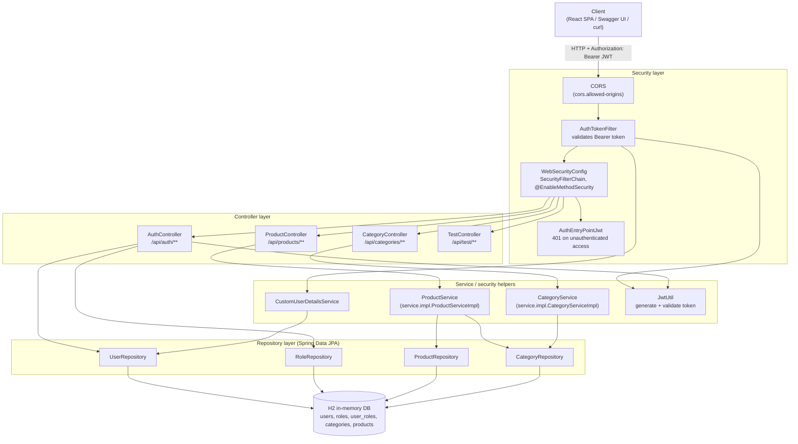
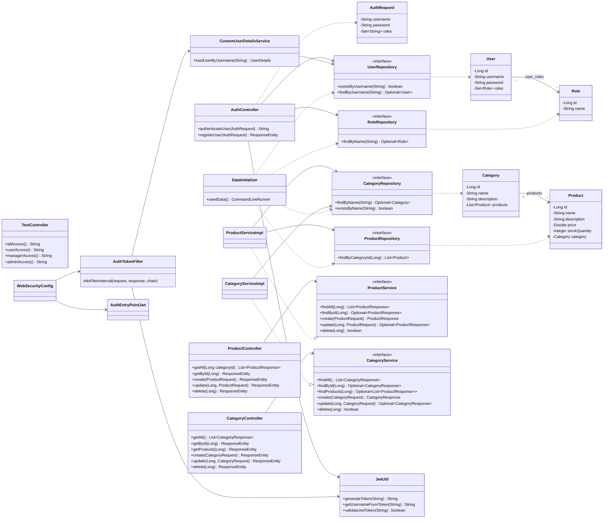
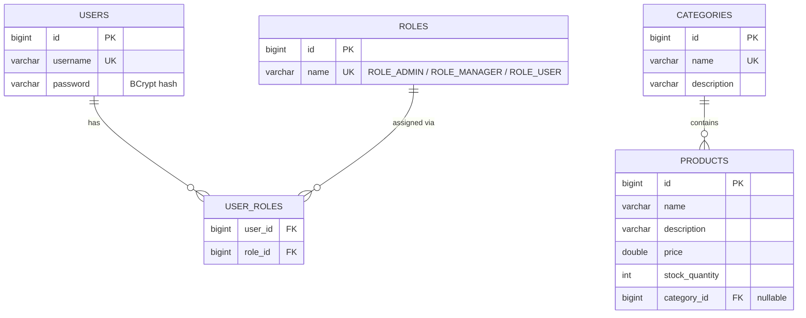
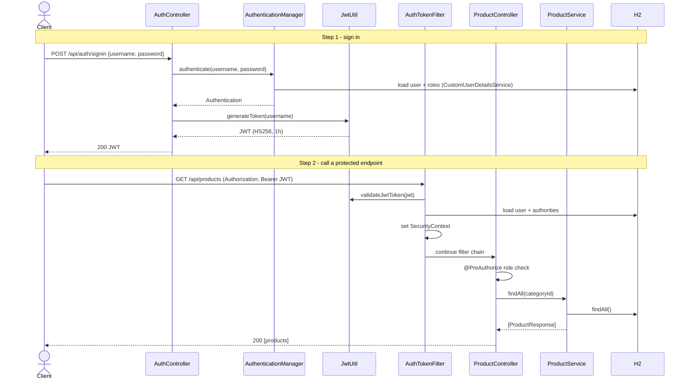

# Spring Boot REST API with JWT

A Product and Category REST API (one category has many products) secured with **JWT authentication** and **role-based authorization** (`USER`, `MANAGER`, `ADMIN`), built with Spring Boot 4, Spring Security, Spring Data JPA and an in-memory H2 database. API documentation is generated with Swagger UI (springdoc-openapi).

## Tech stack

| Area | Technology |
|------|------------|
| Language / build | Java 21, Maven |
| Framework | Spring Boot 4.1.2 (Web MVC, Security, Data JPA) |
| Auth | JWT (jjwt 0.11.5, HS256), BCrypt password hashing |
| Database | H2 (in-memory) |
| API docs | springdoc-openapi 3.0.0 (Swagger UI) |

## Architecture

The diagrams below are [Mermaid](https://mermaid.js.org/) and render on GitHub, GitLab and in the VS Code Markdown preview (with a Mermaid extension).

### 1. Layered component diagram



### 2. Class diagram



### 3. Entity-relationship diagram



### 4. Authentication and request flow



## Access rules

| Endpoint | Method | Access |
|----------|--------|--------|
| `/api/auth/signin`, `/api/auth/signup` | POST | Public |
| `/api/test/all` | GET | Public |
| `/api/test/user` | GET | USER, MANAGER, ADMIN |
| `/api/test/manager` | GET | MANAGER, ADMIN |
| `/api/test/admin` | GET | ADMIN |
| `/api/products`, `/api/products/{id}` | GET | USER, MANAGER, ADMIN |
| `/api/products` | POST | MANAGER, ADMIN |
| `/api/products/{id}` | PUT | MANAGER, ADMIN |
| `/api/products/{id}` | DELETE | ADMIN |
| `/api/products?categoryId={id}` | GET | USER, MANAGER, ADMIN |
| `/api/categories`, `/api/categories/{id}`, `/api/categories/{id}/products` | GET | USER, MANAGER, ADMIN |
| `/api/categories` | POST | MANAGER, ADMIN |
| `/api/categories/{id}` | PUT | MANAGER, ADMIN |
| `/api/categories/{id}` | DELETE | ADMIN (409 if the category still has products) |
| `/swagger-ui.html`, `/v3/api-docs/**`, `/h2-console/**` | GET | Public |

Missing or invalid token gives `401`. A valid token without the required role gives `403`.

## Getting started

### Prerequisites

- JDK 21
- Maven 3.9+ (or the Maven wrapper, if the `.mvn/wrapper` folder is present in your copy)
- Port `8080` free

### Run

```bash
mvn spring-boot:run
```

Or build a jar and run it:

```bash
mvn clean package
java -jar target/spring-boot-rest-api-jwt-0.0.1-SNAPSHOT.jar
```

The app starts on http://localhost:8080. Roles, three users, three categories and seven sample products are seeded automatically at startup (`DataInitializer`).

| Username | Password | Roles |
|----------|----------|-------|
| `admin` | `admin123` | ADMIN, USER |
| `manager` | `manager123` | MANAGER, USER |
| `user` | `user123` | USER |

> These accounts and the `jwt.secret` in `application.properties` are for development only. Change them before any real deployment.

### Useful URLs

| URL | Purpose |
|-----|---------|
| http://localhost:8080/swagger-ui.html | Swagger UI (interactive API docs) |
| http://localhost:8080/v3/api-docs | OpenAPI spec (JSON) |
| http://localhost:8080/h2-console | H2 console. JDBC URL `jdbc:h2:mem:testdb`, user `sa`, password `sa` |

### Configuration (`src/main/resources/application.properties`)

| Property | Default | Description |
|----------|---------|-------------|
| `jwt.secret` | (dev value) | HMAC key used to sign tokens. Must be at least 32 bytes |
| `jwt.expiration` | `3600000` | Token lifetime in ms (1 hour) |
| `cors.allowed-origins` | `http://localhost:3000,http://localhost:5173` | Allowed frontend origins |

## Testing the APIs

### Option A: Swagger UI

1. Open http://localhost:8080/swagger-ui.html.
2. Expand `POST /api/auth/signin`, click **Try it out**, send `{"username":"admin","password":"admin123"}`.
3. Copy the token from the response body.
4. Click **Authorize** (top right), paste the token (without the `Bearer ` prefix), then **Authorize**.
5. Call any endpoint, for example `GET /api/products`.

### Option B: curl

Bash (Git Bash, macOS, Linux):

```bash
# 1. Public endpoint
curl http://localhost:8080/api/test/all

# 2. Sign in and keep the token
TOKEN=$(curl -s -X POST http://localhost:8080/api/auth/signin \
  -H "Content-Type: application/json" \
  -d '{"username":"admin","password":"admin123"}')

# 3. List products
curl http://localhost:8080/api/products -H "Authorization: Bearer $TOKEN"

# 4. Get one product
curl http://localhost:8080/api/products/1 -H "Authorization: Bearer $TOKEN"

# 5. Create a product in category 1 (MANAGER or ADMIN); categoryId is optional
curl -X POST http://localhost:8080/api/products \
  -H "Authorization: Bearer $TOKEN" -H "Content-Type: application/json" \
  -d '{"name":"Desk Lamp","description":"LED lamp","price":19.9,"stockQuantity":30,"categoryId":1}'

# 6. Update a product (MANAGER or ADMIN)
curl -X PUT http://localhost:8080/api/products/1 \
  -H "Authorization: Bearer $TOKEN" -H "Content-Type: application/json" \
  -d '{"name":"Laptop Pro","description":"16-inch laptop","price":1499.0,"stockQuantity":20,"categoryId":1}'

# 7. Delete a product (ADMIN only)
curl -X DELETE http://localhost:8080/api/products/1 -H "Authorization: Bearer $TOKEN"

# 8. List products of one category (two equivalent ways)
curl "http://localhost:8080/api/products?categoryId=2" -H "Authorization: Bearer $TOKEN"
curl http://localhost:8080/api/categories/2/products -H "Authorization: Bearer $TOKEN"

# 9. List / get categories
curl http://localhost:8080/api/categories -H "Authorization: Bearer $TOKEN"
curl http://localhost:8080/api/categories/1 -H "Authorization: Bearer $TOKEN"

# 10. Create a category (MANAGER or ADMIN)
curl -X POST http://localhost:8080/api/categories \
  -H "Authorization: Bearer $TOKEN" -H "Content-Type: application/json" \
  -d '{"name":"Furniture","description":"Desks and chairs"}'

# 11. Update a category (MANAGER or ADMIN)
curl -X PUT http://localhost:8080/api/categories/4 \
  -H "Authorization: Bearer $TOKEN" -H "Content-Type: application/json" \
  -d '{"name":"Office Furniture","description":"Desks and chairs"}'

# 12. Delete a category (ADMIN only; 409 if it still has products)
curl -X DELETE http://localhost:8080/api/categories/4 -H "Authorization: Bearer $TOKEN"
```

Product responses include `categoryId` and `categoryName` (both `null` for an uncategorized product). Category responses include `productCount`.

PowerShell:

```powershell
$token = Invoke-RestMethod -Method Post -Uri http://localhost:8080/api/auth/signin `
  -ContentType "application/json" -Body '{"username":"admin","password":"admin123"}'
Invoke-RestMethod -Uri http://localhost:8080/api/products -Headers @{ Authorization = "Bearer $token" }
```

### Register a new user

```bash
curl -X POST http://localhost:8080/api/auth/signup \
  -H "Content-Type: application/json" \
  -d '{"username":"alice","password":"secret123","roles":["manager"]}'
```

`roles` is optional and defaults to `["user"]`. Accepted values are `user`, `manager` and `admin`. A duplicate username or unknown role returns `400`. Note that the database is in-memory, so registered users disappear when the app restarts.

### Expected results (role checks)

| Scenario | Expected |
|----------|----------|
| `GET /api/products` with no token | `401` |
| `GET /api/products` as `user` | `200` |
| `POST /api/products` as `user` | `403` |
| `POST /api/products` as `manager` | `201` |
| `DELETE /api/products/{id}` as `manager` | `403` |
| `DELETE /api/products/{id}` as `admin` | `204` |
| `GET /api/products/9999` as any role | `404` |
| `GET /api/test/admin` as `manager` | `403` |
| `POST /api/products` with an unknown `categoryId` | `400` |
| `POST /api/categories` with an existing name | `409` |
| `DELETE /api/categories/{id}` that still has products (as `admin`) | `409` |
| `DELETE /api/categories/{id}` with no products (as `admin`) | `204` |

### Run the automated tests

```bash
mvn test
```

## Project structure

```
src/main/java/com/springboot
├── SpringBootRestApiJwtApplication.java   # entry point
├── config/        DataInitializer, OpenApiConfig
├── controller/    AuthController, CategoryController, ProductController, TestController
├── dto/           AuthRequest, CategoryRequest, CategoryResponse, ProductRequest, ProductResponse
├── entity/        User, Role, Category, Product
├── repository/    UserRepository, RoleRepository, CategoryRepository, ProductRepository
├── security/      WebSecurityConfig, AuthTokenFilter, AuthEntryPointJwt, JwtUtil
└── service/       CustomUserDetailsService, CategoryService, ProductService (interfaces)
    └── impl/      CategoryServiceImpl, ProductServiceImpl
```
